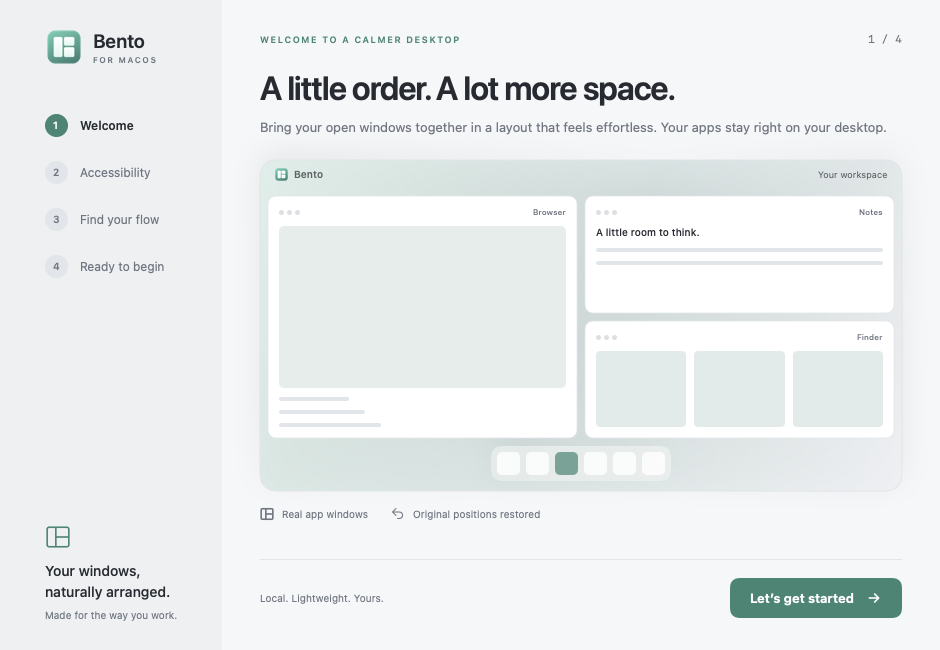
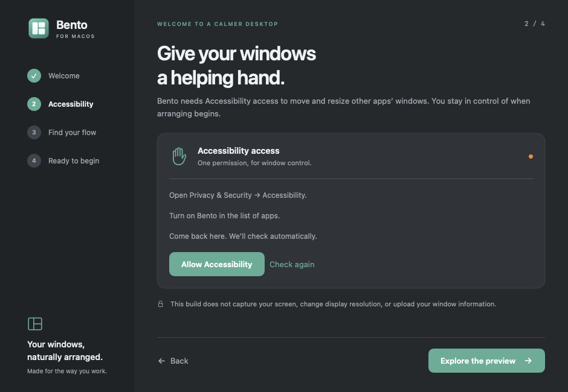

# Bento for macOS — development preview

A native Swift, SwiftUI and AppKit app alongside the existing Windows version. Targets macOS 15+. Uses the pinned official Sparkle 2.10.0 binary for updates. No Electron, screen capture, display-resolution changes or application zoom changes.

## Run

With Xcode installed and its first-launch setup completed:

```sh
macos/scripts/swift.sh test
macos/scripts/build-app.sh
open artifacts/macos/Bento.app
```

Open `macos/Package.swift` in Xcode to edit and debug. The build script makes a standalone `.app`, reuses the original Windows PNG as its Mac icon, embeds Sparkle and its helper processes, signs the local build ad hoc, verifies its signature, and creates an architecture-named ZIP. `BENTO_UNIVERSAL=1` builds Apple Silicon and Intel slices together. Developer ID signing and notarization are optional; GitHub OTA uses Bento's own Ed25519 signing key. See [OTA.md](OTA.md) for publishing.

Keep the app at a stable path when granting Accessibility permission. Rebuilding or moving a development app can require renewing permission. Launch the app bundle, not `swift run`, for normal use.

If an installed toolchain is usable before Xcode setup finishes, set `BENTO_SWIFT` to its full `swift` path and `SDKROOT` to its Mac SDK path. In an already restricted execution environment that cannot nest SwiftPM's manifest sandbox, `BENTO_SWIFT_NO_SANDBOX=1` disables only that build-time sandbox. Normal local and CI builds leave it enabled. All caches stay under the ignored `.build` directory.

## Onboarding

Four native screens use the Windows palette, original Bento icon, and original line-icon paths:

1. **Welcome:** an illustrated desktop explains the app.
2. **Accessibility:** live permission state, System Settings link, and manual recheck. A preview route is available without permission.
3. **Find your flow:** add a fourth illustrated window or swap two in the in-app preview. Actual windows never move in this step. Respects Reduce Motion.
4. **Ready:** eligible-window count, gap selection and the explicit first-arrangement action. Arrangement is disabled without permission; finishing setup without arranging is supported.

Light and dark appearance follow the system or the selected setting. Onboarding can be reopened from the menu bar or About page. It is marked complete only on the final step. Settings are stored locally under `~/Library/Application Support/Bento/`.




## Implemented in this milestone

- Menu-bar left-click toggle, right-click menu, native settings and configurable (or disableable) Control–Option–B toggle; shortcut registration failure leaves the menu-bar controls available.
- Accessibility permission checks and public AX window discovery. The app excludes its own windows, hidden apps, minimized/fullscreen/fixed-size windows, and windows without matching public on-screen metadata.
- Automatic constraint-aware recursive arrangement on each window's current display; display work areas exclude the Dock and menu bar.
- Swift port of Windows automatic layout, insertion/removal, four-direction placement, center swapping, ratio resizing, bounded undo/redo and hold-to-split intent policy, connected to the native interaction controller.
- Native geometry validation before writes, pre-activation snapshots, post-write bounds verification, best-effort rollback, original-position restoration on toggle-off and normal quit.
- One-second membership and display checks while active. Membership changes preserve existing ratios where feasible. Display changes rebuild against current visible areas. Permission revocation pauses management.
- Mac-specific saved layouts, matching bundle identifier and title, with missing windows left floating. Disconnected display layouts are not silently reassigned.
- Separate GitHub Actions checks for Mac builds/tests and Windows shared geometry contracts.
- Native pointer/AX tracking connects quick center/edge swaps and timed edge splits to click-through previews of the final destination and changed neighboring slots, with hold progress and text-free swap/split symbols. Infeasible targets display an orange conflict symbol; releasing outside a valid slot restores the committed layout.
- Gap-only nonactivating resize panels, hidden idle grips that appear on hover and extend to 104 points while held, above native window shadows and the dimmer, coalesced live native resizing, one undo step per gesture, cancellation rollback, and native inner-border resize tracking.
- Optional auto-hide Dock/menu bar and native screen-edge snapping policy while Bento is active. Defaults preserve system behavior. Exact preference values (including absent keys) are journaled before changes, restored on deactivation/quit, and recovered next launch after an interrupted session. A manual preference change made during a session takes precedence on restore. Dock/tiling changes restart the Dock briefly.
- Sparkle checks, opt-in automatic checks/downloads, signature verification before extraction, update UI/menu entry and restoration before restart. Local previews without an embedded publisher key explain why OTA is unavailable. Publishing does not require an Apple Developer ID.

## Architecture and parity decisions

`Sources/BentoCore/` is a pure Foundation geometry package. It mirrors the existing C# algorithms instead of embedding a .NET runtime. Integer logical points are used on Mac, while the Windows adapter keeps physical pixels. Shared fixture coordinates are abstract units; ties-to-even rounding is explicit on both sides. AppKit/AX coordinate conversion happens only in `WindowSystem.swift`.

`Sources/BentoMac/` contains the OS adapter, transaction controller, SwiftUI onboarding/settings, menu bar and shortcut. `Resources/bento.png` and `bento.svg` are exact copies of the Windows originals. `Design.swift` copies theme values and the original vector paths used in the interface.

Windows saved files use executable paths and monitor names. Mac saved files are intentionally separate (`saved-layout-macos.json`, schema 1) and use bundle IDs and display UUIDs. Ratios and behavior can be shared; application and monitor identities are platform-specific. No Windows settings or saved files are rewritten by this app.

## Current limits

The Mac version includes backdrop dimming, configurable shortcuts, floating-window release, saved layouts, undo/redo, edited-layout resume and Start at login. Activation, restoration and committed layout changes use a shared-clock eased transition; slow AX clients skip stale animation frames. Live grip resizing is direct. Both animations and grip feedback respect Reduce Motion. Overflow windows minimize to the Dock by default; opening or restoring a window gives it priority in the split tree. When space is full, Bento minimizes the least recently used windows first, tracking focus changes and clicks. Existing layout edits are preserved when all windows fit. Full layouts reuse an idle window’s exact slot when possible. Automatic admission has no transition animation and allows only one correction for a newly learned native size; unchanged failed inputs do not trigger another automatic attempt. Deactivation restores only Bento-owned minimizations. Settings and layouts save automatically. The default hold delay is 900 ms. Physical title-bar routing still needs a reliable interactive pass. Real AX geometry has been checked in a separate fixture process, and activation plus temporary desktop preferences have been checked in the installed app; the isolated native harness supplies pointer samples and controls only disposable windows.

Minimum window sizes start at 160 × 120 points because a universal minimum-size AX attribute is unavailable. Rejected native sizes teach Bento an app’s actual minimum, followed by a bounded reflow retry. An app may still refuse a resize; the controller checks actual bounds and attempts rollback. Writes across multiple apps cannot be atomic. Restoration is best effort when an app exits or access is revoked. Hard crashes cannot restore the session-only original-position snapshot. No automatic app launching, Spaces switching or full-screen management is performed.

## Validation

See [VALIDATION.md](VALIDATION.md) for actual checks and outstanding physical testing. Engine tests and onboarding screenshots do not prove third-party Accessibility control.

Render the real SwiftUI onboarding screens without arranging any windows:

```sh
artifacts/macos/Bento.app/Contents/MacOS/Bento --render-preview /tmp/bento-preview
```

This renders eight PNGs (four steps in light and dark). `--smoke` exits before window discovery or arrangement. The normal Mac checks build an artifact without signing secrets. The separate **Publish macOS app and OTA** workflow uses the encrypted release secret to publish the Mac ZIP and signed feed.

`--render-settings /tmp/bento-settings` renders Workspace, Gestures and Updates in light/dark. `--interaction-smoke /tmp/bento-interactions` exercises the production gesture controller against disposable native NSWindows using an injected window backend and supplied input; it does not touch other apps or OS preferences. `macos/scripts/test-ota.sh` generates a disposable key and verifies an ad-hoc app's signed archive/feed and corruption rejection without Developer ID or Keychain changes.

## Start at login

Workspace → **Start at login** uses Apple’s `SMAppService.mainApp`. macOS owns the registration state and may require approval in System Settings → General → Login Items. Login launches stay in the menu bar once onboarding is complete. The option defaults to off; no login registration is enabled by tests. Keep the app in a stable Applications folder.

`macos/scripts/test-external-ax.sh` builds a separate disposable app and verifies real AX discovery, arrangement, all four split directions, swap, resize, undo/redo and restoration. Only the fixture process can be touched. Physical pointer routing and sign-out/login remain separate interactive checks. Online Sparkle installation and relaunch were verified for the published app; see VALIDATION.md.

## Stable app identity for Accessibility

Starting with 0.2.5, OTA releases use a persistent self-signed RSA code-signing certificate and an explicit designated requirement pinned to that certificate and `com.abdullahegh.bento`. Unlike the old ad-hoc signature, this requirement does not include a build's changing code hash. The code-signing identity is separate from Sparkle's Ed25519 update-signing key: both are required for publication. This is identity continuity, not Developer ID notarization, and does not automatically grant a permission.

The first migration from an ad-hoc build needs one final Accessibility approval for the new identity. Subsequent correctly signed versions are designed to retain that approval. Revoking access or changing/losing the certificate still requires approval again. Actual permission retention across an installed update must be distinguished from the automated signature-continuity test.

Only `CodeSigningCertificate.pem` is public. `create-code-signing-identity.py` creates a private dedicated keychain plus an encrypted PKCS#12 backup in `~/Library/Application Support/BentoSigning`; its password is stored in the user's Keychain under service `Bento Code Signing Backup`. The script never replaces an existing identity. Keep this backup and restore the same identity when moving development machines; do not generate a new release certificate per build.

GitHub uses `BENTO_MACOS_CODESIGN_P12` (base64 of the encrypted PKCS#12) and `BENTO_MACOS_CODESIGN_PASSWORD` as encrypted secrets. The workflow imports them into an ephemeral runner keychain, signs all components, pins the app requirement, checks a different version against the same requirement, and removes the keychain afterward. Production OTA builds reject an ad-hoc fallback. These secrets must be explicitly provisioned by the repository owner; source checkout alone cannot sign a release.

## Split and relocation QA

Native drags bind to the AX window under the initial pointer, with committed slot geometry as the baseline for fast drags. A return to the starting frame alone does not cancel a valid destination; Escape, an invalid target, or a rejected native transaction still recovers the committed layout. Background membership checks pause while the pointer is held, confirm transient missing live windows, and recheck pointer state before applying automatic changes.

Split previews cache the candidate tree for each target and placement. Stationary holds update progress without polling native frames, and successful drops apply one final frame after the native mouse-up handoff. The final native border-resize sample is included on release. Closing a source or target recovers the surviving windows. The isolated native QA harness covers both landscape and portrait layouts.

Live transition traces use the local macOS log under subsystem `com.abdullahegh.bento`, category `Interaction`. Events include gesture starts, proposed bounds, cancellation, native rollback and committed history, without window titles or contents. The isolated harness also writes `gesture-trace.log` beside its JSON results. No trace is uploaded automatically.

Toggle resume reconciles the saved tree against live window identities, retaining slot IDs, ratios and display ownership. Floating exclusions and Bento-owned minimizations survive the off/on cycle. Resume does not call automatic packing; unavailable geometry fails before native writes. Floating native drags use the shared insertion rule (right for a wide slot, bottom for a tall slot); managed center drops swap, held edges split, and gaps remain non-droppable. Native minimum-size feedback gets at most one correction of the same split tree and is retained in interaction history.

Desktop overrides update live through a per-key journal: disabling Dock/menu-bar hiding or returning snapping to Keep releases just that override, retaining each original pre-Bento value. Gap and margin edits coalesce over 120 ms and wait for native gestures to finish. Interactions use applied spacing, so previews and grabbers never get ahead of pending settings. Work-area refresh preserves display ownership and split identity where feasible. Admission first tries a local split, then one bounded in-memory arrangement that keeps all existing apps, before LRU eviction; stable native frame drift is confirmed twice before constraint reconciliation. Bento's own settings pointer input cannot bind to an underlying tiled window.

### Whole-section screen-edge movement

A managed window dragged into the outermost 20 points of its own screen moves its containing section toward that edge. Bento exchanges the outermost eligible sibling subtrees, mirroring the measured divider ratio so both sections keep their sizes even when native minimum sizes clamped the saved ratio. A large right slot and a stacked left group therefore exchange sides as complete sections. Internal splits, window identities and other displays remain unchanged. An already outermost section does not create a new split. Preview outlines include all changed slots; the section move animates on release and remains undoable. Normal slot interiors retain quick swaps and held splits. Screen geometry is captured once per drag and proposals are cached per edge.

Closing a tiled window animates the remaining branch collapse on the first arrangement attempt; native refusal recovery retains the bounded final-frame path. Grabber panels occupy level -1, between normal application windows (0) and the dimming backdrop (-2), so app content and shadows cover them.

The menu-bar control remains enabled in both states: off uses a dim white outline at 45% opacity; active uses solid white sections at full opacity. Images are cached and switch when committed activation state changes.
